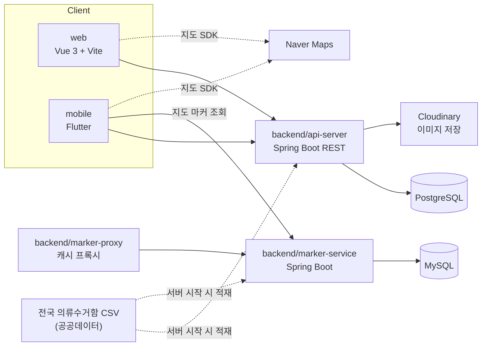

# DropIt — 의류수거함 위치 찾기 & 의류 나눔

전국 의류수거함 위치를 지도에서 찾고, 후기와 나눔 게시글을 남길 수 있는 서비스입니다.
웹(Vue)과 모바일(Flutter) 클라이언트, Spring Boot REST API 서버로 구성된 **신한대학교 마이크로스톤 팀 프로젝트**입니다. (활동 기간 2025.03 ~ 2025.10)

## 주요 기능

- **지도 기반 수거함 조회** — 네이버 지도 위에 전국 의류수거함 마커 표시, 현재 위치 이동, "이 위치에서 다시 검색"(지도 화면 범위 조회), 마커 클러스터링
- **검색** — 지역명 검색 (시/도 단위 동의어 처리: 예 `전북` ↔ `전라북도` ↔ `전북특별자치도`)
- **수거함 상세 / 후기 / 즐겨찾기** — 수거함별 후기(사진 포함) 작성, 즐겨찾기(찜) 등록
- **나눔 게시판** — 의류 나눔 글 작성·수정·삭제, 사진 업로드, 지도에서 위치 지정
- **회원 기능** — 회원가입(약관 동의), 로그인, 아이디/비밀번호 찾기, 마이페이지(프로필 사진, 비밀번호 변경, 회원 탈퇴)

## 아키텍처

| 모듈 | 설명 | 스택 |
| --- | --- | --- |
| [`backend/api-server`](backend/api-server) | 회원·게시판·후기·즐겨찾기·수거함 조회를 제공하는 메인 REST API | Java 21, Spring Boot 3.5, Spring Data JPA, Spring Security(BCrypt), springdoc-openapi, Cloudinary, PostgreSQL |
| [`backend/marker-service`](backend/marker-service) | 수거함 마커 조회 전용 서비스 (반경 / 지도 범위 조회) | Java 17, Spring Boot 3.5, JPA, MySQL |
| [`backend/marker-proxy`](backend/marker-proxy) | marker-service 앞단의 중간 서버 (RestTemplate 호출, 캐시 설정 포함) | Java 21, Spring Boot 3.5 |
| [`backend/prototypes`](backend/prototypes) | `api-server`로 합쳐지기 전 단계별 초기 백엔드 3종 (공공데이터 API 호출 / 게시판·회원 / JWT 인증) | Spring Boot, Spring JDBC, JPA, Spring Security, jjwt |
| [`web`](web) | 웹 클라이언트 | Vue 3, Vite, Pinia, Vue Router, Axios, Naver Maps JS |
| [`mobile`](mobile) | 모바일 앱 | Flutter(Dart 3.8), flutter_naver_map, Provider, geolocator |

## 담당 역할

- 백엔드·DB·사용자 관리 (Java, Spring Boot, MySQL)
- 위치 데이터는 공공데이터를 가져와 서버 DB에 적재해 활용했습니다.

## 데이터

- 처음에는 공공데이터포털의 전국 의류수거함 위치 정보 API(odcloud)를 호출해 가져오는 방식으로 시작했고([`prototypes/public-data-client`](backend/prototypes/public-data-client)), 이후 CSV 파일을 DB에 적재해 사용하는 방식으로 바꿨습니다.
- `backend/*/src/main/resources/csv/전국_의류수거함.csv` — 도로명주소, 지번주소, 위도, 경도 (약 3.5만 건, 인코딩 EUC-KR)
- 서버 시작 시 DB가 비어 있으면 CSV를 읽어 적재하고, 좌표가 같은 데이터는 중복 저장하지 않습니다. (`ClothingBinLoader`)
- 데이터 출처: 공공데이터포털 「전국 의류수거함 위치 정보」 API (이용 조건은 공공데이터포털의 해당 데이터 페이지 참고)

## 실행 방법

각 모듈의 README를 참고하세요. 공통으로 **API 키·DB 비밀번호는 저장소에 포함되어 있지 않고** 환경변수로 주입합니다.

| 모듈 | 설정 파일 |
| --- | --- |
| api-server | [`.env.example`](backend/api-server/.env.example) |
| marker-service | [`.env.example`](backend/marker-service/.env.example) |
| web | [`.env.example`](web/.env.example) |
| mobile | [`dart-define.example.json`](mobile/dart-define.example.json) |

네이버 지도 Client ID는 [네이버 클라우드 플랫폼 Maps](https://www.ncloud.com/product/applicationService/maps)에서 발급받아야 합니다.

## API

주요 엔드포인트는 [docs/API.md](docs/API.md)에 정리했습니다.

## 개발 과정

서버 렌더링(Thymeleaf) 구조에서 JSON REST API 구조로 바꾸고, 마커 조회를 별도 서비스로 분리해 온 과정은 [docs/DEVELOPMENT_HISTORY.md](docs/DEVELOPMENT_HISTORY.md)에 기록했습니다.

## 알려진 한계 / 개선 예정

- 로그인 성공 시 사용자 정보만 응답하고 토큰(JWT)·세션은 발급하지 않으며, 모든 요청을 허용(`permitAll`)하는 구조 → 인증/인가 도입 필요 (JWT 로그인은 [`prototypes/cloth-area-jwt`](backend/prototypes/cloth-area-jwt)에서 먼저 구현했으나 `api-server`에는 반영되지 않음)
- 반경 검색(`GET /api/clothing-bins`)은 MySQL 전용 함수(`ST_Distance_Sphere`)를 사용하므로 PostgreSQL 환경에서는 동작하지 않을 수 있음 (지도 범위 조회 `/in-bounds`는 표준 SQL)
- CORS 허용 origin이 `http://localhost:5173`으로 고정되어 있어 배포 도메인 설정 필요
- 자동화 테스트 부족 (기본 컨텍스트 로드 테스트만 존재)
